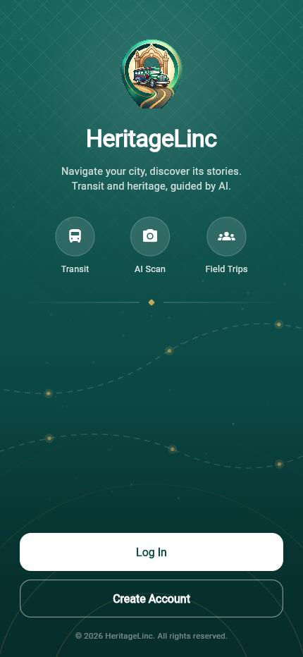
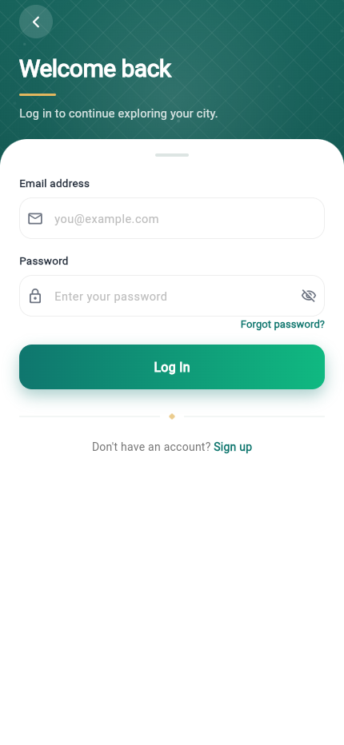

# HeritageLinc

A Flutter prototype for heritage-focused travel and educational visits, with role-specific dashboards, saved trips, transit service code, and weather information.

The project connects a mobile interface to Supabase account and trip services. Its broader product direction includes transit guidance and museum learning; the current implementation status is documented below.

## My role

**Project lead and sole software developer — [Julian](https://github.com/Julian-Dev-Web).**

I developed the Flutter interface, feature structure, account flows, role-specific dashboards, and Supabase/service integration. This repository presents my software implementation within the group project.

## Screenshots

<p>
  
  
</p>

Captured from a local Flutter web build on October 22, 2026 at a mobile viewport. These are the actual public screens; no account was used and no backend data was changed. The landing page's AI branding describes the product direction, not completed AI functionality.

## Implementation status

| Area | Current source |
| --- | --- |
| Accounts | Registration, sign-in, confirmation/reset requests, and profile services |
| Role-specific home | Separate commuter, student, and teacher dashboards |
| Saved trips | Create, edit, search, favorite, and delete through Supabase |
| Weather | Open-Meteo forecast and place-search service, with dashboard widgets |
| Transit | Route-search/fare service and a separate transit screen exist; the main Home transit tab is still a placeholder |
| Heritage Lens / AI scan | Placeholder in the current Home navigation |
| Geofenced alerts and guided museum AI | Product direction; not established as complete by this repository |

Some dashboard content comes from sample data. This repository should be evaluated as a prototype, with implemented screens and integration code distinguished from planned modules.

## Technology

- Flutter and Dart
- Supabase Flutter for authentication and backend access
- HTTP services for weather and geocoding
- Flutter SVG and custom themed widgets
- flutter_dotenv for public client configuration

## Project structure

```text
lib/core/           Routes, themes, shared widgets, validation, Supabase setup
lib/features/auth/  Accounts, profiles, registration, and role data
lib/features/home/  Commuter, student, and teacher dashboards
lib/features/transit/
                    Route and fare services plus the transit screen
lib/features/trips/ Saved-trip data service and screens
lib/features/weather/
                    Weather, geocoding, and dashboard widgets
assets/             Bundled images and icon directory
test/               Existing Flutter starter test
```

## Run locally

Use a compatible Flutter SDK with Dart 3.3 or later within Dart 3, then:

```sh
flutter pub get
```

Copy `.env.example` to `.env` in the project root and configure your own backend:

```dotenv
SUPABASE_URL=https://YOUR_PROJECT_REF.supabase.co
SUPABASE_ANON_KEY=YOUR_PUBLIC_ANON_OR_PUBLISHABLE_KEY
```

```sh
flutter run
```

The app expects a matching Supabase backend for profiles, role information, school/verification records, saved trips, and transit RPCs. A complete backend schema installer is not included here. Platform folders are included, but every platform has not been independently verified.

`.env` is bundled as a Flutter asset and therefore must contain only public client configuration. Keep service-role keys, passwords, and private API credentials on a server. Database authorization must be enforced by Supabase policies.

## Development checks

```sh
flutter analyze
flutter test
flutter build web
```

The existing widget test still contains starter counter-app assertions and needs project-specific coverage. The public-screen web build and screenshots do not establish end-to-end account, transit, geofencing, or AI behavior.

A separate [administration repository](https://github.com/Julian-Dev-Web/heritagelinc-admin) is available for the wider project.
